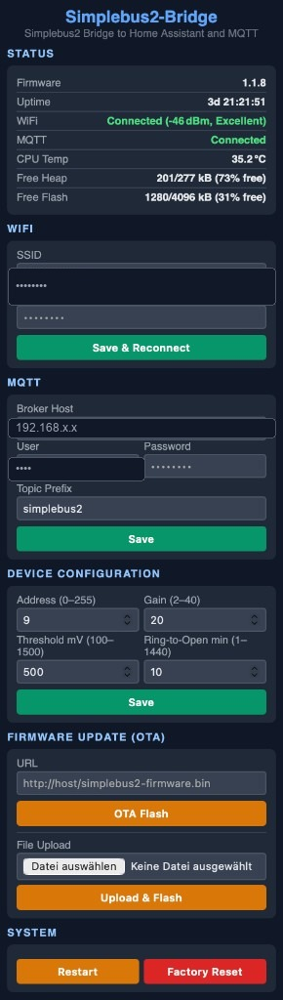

# Simplebus2-Bridge — Setup Guide

**Firmware:** 2.0.0  
**Hardware:** ESP32-C3  
**Framework:** Arduino / PlatformIO

---

## Prerequisites

### Hardware

| Item | Notes |
|------|-------|
| ESP32-C3 board (e.g. DevKitM-1) | Tested with `esp32-c3-devkitm-1` |
| Simplebus2 intercom system | Außenstelle (entry door) and/or Innenstelle (floor door) |
| Intercom signal tap | Read pin (GPIO2), optional write pin (GPIO3) |
| MCP4017 digital potentiometer | I2C address 0x2F, connected to SDA_1/SCL_1 (GPIO6/7) |
| USB cable | For initial flash |
| MQTT broker | e.g. Mosquitto on Home Assistant, accessible in your network |

### Software

- [PlatformIO](https://platformio.org/) (VS Code extension or CLI)
- ESP32 Arduino core (installed automatically by PlatformIO)
- Optional: [Home Assistant](https://www.home-assistant.io/) with MQTT integration

---

## 1. Build and Flash Firmware

### Clone / open the project

```
simplebus2-mqtt-bridge/
├── src/
│   ├── main.cpp
│   └── web_ui.h
├── lib/
│   └── Debounce/
├── platformio.ini
```

### Build

```bash
cd simplebus2-mqtt-bridge
pio run
```

Expected output:
```
RAM:   [=         ]  13.3% (43732 / 327680 bytes)
Flash: [=======   ]  73.8% (967242 / 1310720 bytes)
[SUCCESS]
```

### Flash (USB)

```bash
pio run -t upload
```

If the device does not enter download mode automatically:
1. Hold **BOOT** button
2. Press and release **RESET**
3. Release **BOOT**
4. Re-run `pio run -t upload`

---

## 2. First Boot — WiFi Setup

On first boot (or after factory reset), the bridge opens a WiFi access point:

| Property | Value |
|----------|-------|
| SSID | `Simplebus2-Bridge` |
| Password | *(open, no password)* |
| Portal URL | `http://192.168.4.1/` |

**Steps:**

1. Connect your phone or laptop to the `Simplebus2-Bridge` WiFi network.
2. A captive portal opens automatically (or navigate to `http://192.168.4.1/`).
3. Enter your home WiFi **SSID** and **password**.
4. Tap **Save**. The bridge connects to your network and the portal closes.

> **Note:** The captive portal only asks for WiFi credentials. All other settings (MQTT, device parameters) are configured via the permanent web interface after connection.

---

## 3. Access the Web Interface

Once connected to your WiFi network:

| Method | Address |
|--------|---------|
| mDNS hostname | `http://Simplebus2-Bridge.local/` |
| IP address | Check your router's DHCP table, or the MQTT status topic |

The dashboard loads automatically. It auto-refreshes the Status section every 5 seconds.



Sections: **Status** (firmware, uptime, WiFi/MQTT, heap/flash) → **WiFi** → **MQTT** (broker, credentials, topic prefix) → **Device Configuration** (address, gain, threshold, Ring-to-Open duration) → **Firmware Update (OTA)** → **System** (restart / factory reset).

---

## 4. Configure MQTT

In the **MQTT** section of the web interface:

| Field | Description | Example |
|-------|-------------|---------|
| Broker Host | IP or hostname of your MQTT broker | `192.168.1.10` |
| User | MQTT username (leave blank if none) | |
| Password | MQTT password (leave blank if none) | |
| Topic Prefix | Prefix for all published topics | `SimpleBus` |

Click **Save**. The bridge reconnects to the MQTT broker immediately.

> If you change the **Topic Prefix**, a notice appears: *"Restart required for prefix change to take effect."* Use the **Restart** button in the System section.

### MQTT Topics (default prefix `SimpleBus`)

| Topic | Payload | Event |
|-------|---------|-------|
| `SimpleBus/EntryDoor` | `ON` | Ring at entrance (Außenstelle) |
| `SimpleBus/FloorDoor` | `ON` | Ring at floor door (Innenstelle) |
| `SimpleBus/RingToOpenStatus` | `ON` / `OFF` | Ring-to-Open active or deactivated |
| `SimpleBus/RingToOpenOpened` | `ON` | Door opened via Ring-to-Open |

---

## 5. Configure Device Parameters

In the **Device Configuration** section:

| Field | Range | Default | Description |
|-------|-------|---------|-------------|
| Address | 0–255 | 9 | Intercom address to listen for |
| Gain | 2–40 | 20 | Amplifier gain for signal detection |
| Threshold mV | 100–1500 | 600 | Detection threshold in millivolts |
| Ring-to-Open min | 1–1440 | 600 | Duration Ring-to-Open stays active (minutes) |

Click **Save**.

> **Ring Automation** (Ring-to-Open auto-open) is controlled exclusively via Home Assistant or MQTT (`<prefix>/RingToOpen` topic). It is not configurable from the web interface.

---

## 6. Home Assistant Integration

The bridge publishes MQTT Auto Discovery payloads on boot. Home Assistant picks them up automatically if the MQTT integration is configured.

**Discovered entities (under device "Simplebus2-Bridge"):**

| Entity | Type | Description |
|--------|------|-------------|
| Entry Door | Binary Sensor | Doorbell at entrance |
| Floor Door | Binary Sensor | Doorbell at floor |
| Ring To Open | Switch | Enable/disable Ring-to-Open via HA |
| Ring To Open Status | Binary Sensor | Current Ring-to-Open state |
| Open Door | Button | Trigger door opener |
| Intercom Address | Number | Device address setting |
| Gain | Number | Amplifier gain |
| Threshold | Number | Detection threshold mV |
| Ring To Open Duration | Number | Ring-to-Open active duration (min) |

**Prerequisite:** In Home Assistant, go to **Settings → Devices & Services → MQTT** and ensure the broker is configured with the same host/port you set in the bridge's MQTT section.

---

## 7. OTA Firmware Update

> **Upgrading from the previous public sketch (pre-2.0.0):** EEPROM settings are **not** migrated. After the first boot you must **re-enter MQTT broker/credentials, address, gain, and threshold** in the web UI. WiFi usually remains. See the README section *Upgrading from older firmware*.

Two methods are available in the **Firmware Update (OTA)** section.

### Option A — URL

Enter a direct `http://` URL pointing to a `.bin` file and click **OTA Flash**.

```
http://192.168.1.20:8080/firmware/simplebus2/firmware.bin
```

> HTTPS and HTTP redirects are not supported. The URL must resolve from within your local network.

### Option B — File Upload

1. Click the file input and select a local `.bin` file.
2. Click **Upload & Flash**.
3. A progress bar shows the upload percentage.
4. On completion the device flashes and reboots automatically.

> The `.bin` file is the compiled firmware binary: `simplebus2-mqtt-bridge/.pio/build/esp32c3/firmware.bin`

---

## 8. Factory Reset

In the **System** section, click **Factory Reset** and confirm. The device:

1. Erases all NVS/EEPROM settings (WiFi credentials, MQTT config, device parameters)
2. Reboots
3. Opens the `Simplebus2-Bridge` WiFi portal (see Step 2)

Proceed from Step 2 to reconfigure.

---

## 9. Troubleshooting

### Bridge does not appear on the network

- Check power and USB/serial connection.
- Confirm the bridge joined your WiFi: look for `Simplebus2-Bridge` in your router's DHCP table.
- If not joined: connect to the `Simplebus2-Bridge` AP and reconfigure WiFi (see Step 2).

### `Simplebus2-Bridge.local` not resolving

- mDNS may not work on all networks. Use the IP address directly instead.
- On Android, mDNS often requires an app (e.g. mDNS Browser). Use the IP address as a fallback.

### MQTT not connecting

- Verify broker host and port (default 1883) in the web interface.
- Check that the broker is reachable from the bridge's network.
- If authentication is required, set username and password in the MQTT section.
- Check the bridge logs via MQTT: subscribe to `SimpleBus/#` and watch for availability messages.

### No rings detected

- Confirm the intercom address matches the setting in Device Configuration (default: 9).
- Adjust the gain (lower gain = less amplification, try increasing if signal is weak).
- Lower the threshold if no events appear; raise it if there are false positives.

### Web interface not accessible after update

- Try the IP address instead of the mDNS hostname.
- Check that port 80 is not blocked by a network firewall.
- If the device appears stuck, use the **Restart** button or power-cycle. If unresponsive, reflash via USB.

---

## 10. Wiring Reference

| Function | ESP32-C3 GPIO |
|----------|--------------|
| LED indicator | GPIO 4 |
| Simplebus2 read | GPIO 2 |
| Simplebus2 write | GPIO 3 |
| Button | GPIO 8 |
| I2C SDA (primary) | GPIO 6 |
| I2C SCL (primary) | GPIO 7 |
| I2C SDA (secondary) | GPIO 9 |
| I2C SCL (secondary) | GPIO 10 |
